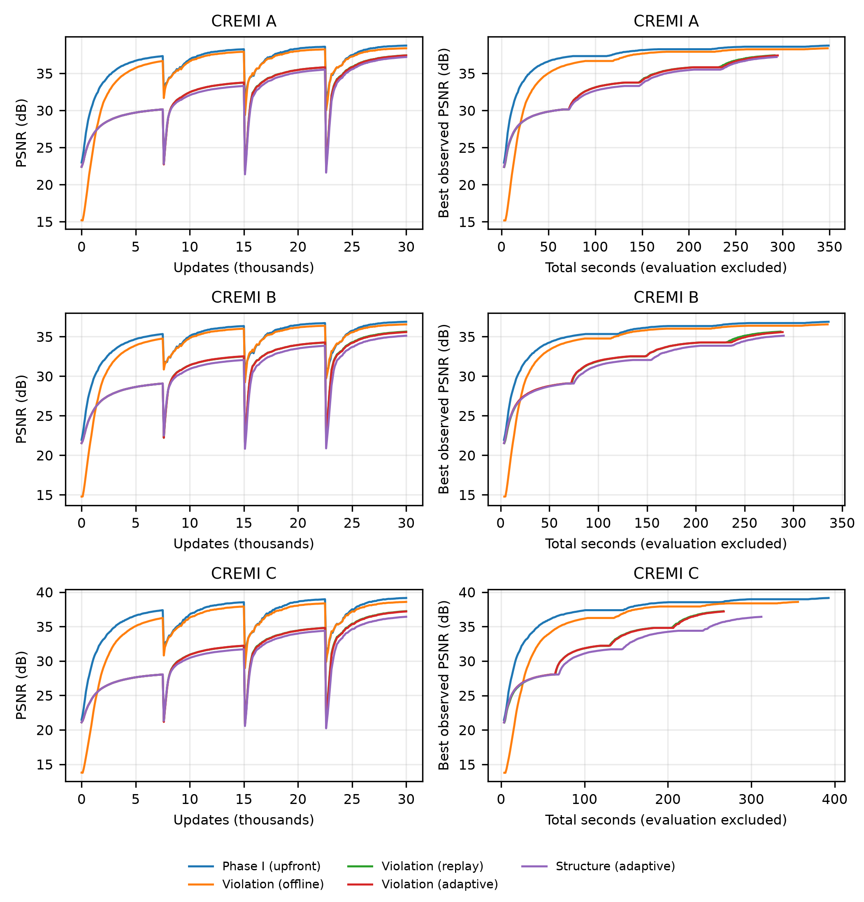

# Capacity-matched densification and allocation timing

The executable experiment is `scripts/allocation_ablation.py`. All five arms use
the same additive field, renderer, volumetric supervision, loss, slice sequence,
learning rates, cycle boundaries and Adam restarts. The final capacity is the
actual count of default Phase I for that volume, not its memory safety limit.
There is no pruning or subsequent re-estimation. Every arm receives 30,000
updates: four cycles of 7,500, with three allocation opportunities. This schedule
is a separate control experiment, not the paper's three-cycle full method.

| Arm | Allocation | Purpose |
| --- | --- | --- |
| `phase1_upfront` | Default Phase I before training | Reference at exactly the same final capacity |
| `structure_online` | Recompute structure scores on fitted Gaussians at 7,500, 15,000 and 22,500 updates | Capacity-matched structure-aware densification baseline |
| `violation_upfront` | Apply a frequency-aware violation split tree before any update | Offline volume-adapted SAD-GS-style allocation |
| `violation_replay` | Replay that identical tree at the three allocation opportunities | Delayed member of the timing pair |
| `violation_online` | Recompute frequency-aware violation scores on fitted Gaussians at each opportunity | Adaptive volume-based frequency-aware densification |

The structure score for local axis k is s_k sqrt(u_k^T J u_k), where J is the
same aggregated structure tensor used by Phase I. It inherits Phase I's band
weighting, but does not use a wavelength or violation threshold. The violation
arms instead use the exact support-aggregated directional wavelength violation
from `phase1.violation`. Each round bisects the highest scoring parents along
their highest scoring axis. Stable ordering resolves ties. Binary splits permit
exact counts: each selected parent adds one Gaussian. Approximately geometric
intermediate counts are shared by all delayed arms. Initial parents have the
same tensor-oriented frames and calibrated amplitudes. Every split uses the
same least-squares amplitude transfer. These are volume-native adaptations of
the allocation concepts, not reproductions of the original multi-view SAD-GS
pipeline. All scores use the same scalar volume; there are no view-dependent
signals or differences in supervision.

The frozen violation tree stores row indices and local split axes. Applying its
complete sequence to unoptimised parents generates `violation_upfront`; replay
applies the same decisions in the fitted parents' current frames. Geometry and
amplitudes therefore evolve differently, as a consequence of allocation timing.
With zero optimisation between events, replay produces exactly the same
parameters. This pair isolates moving allocation relative to optimisation while
holding the allocation decisions fixed. Comparing Phase I against either
adaptive online arm also changes the allocation rule and is not evidence of a
timing-only benefit.

Run all five arms on CREMI A, B and C, once each (seed 0, as requested):

```bash
micromamba run -n gaussian-volume python scripts/reproduce_allocation.py
```

Or run one volume:

```bash
micromamba run -n gaussian-volume python scripts/allocation_ablation.py \
  data/cremi/cremi_a.tif --spacing 40,4,4 --out runs/allocation/cremi_a
```

`allocation.json` records configuration, environment, exact counts, split trees,
metrics and traces. Each completed arm also saves its metrics and model; progress
is streamed to `progress.jsonl`. Report per-volume PSNR, SSIM and MAE, and paired
differences (violation_upfront minus violation_replay). This single-seed experiment
does not measure seed variability. Plot quality against both updates and total
seconds, and population against updates. Include final count, allocation overhead,
and quality immediately before and after allocation when interpreting discontinuities.

Timing excludes metric evaluations, includes shared analysis for every arm, and
charges frozen-tree construction to both timing-pair arms. The implementation
conservatively charges shared reference Phase I preparation to every arm as well;
report this shared cost separately. The online arms build their scores at each
event. Iteration matching is not compute matching: upfront arms optimise more
Gaussians for longer. Compare at common elapsed-time checkpoints within the
measured overlap as well as at 30,000 updates; do not extrapolate or claim a timing
benefit from final PSNR alone. Timings include any display workload on the GPU.

The summary also reports best-observed quality within the common time budget and
time to reach reference final PSNR minus 1 dB. These are descriptive, post-run
comparisons; the target is derived by the same rule for each volume. Learning-rate
restarts can temporarily lower PSNR, so distinguish the last evaluated model from
the best previously observed quality. The script saves final models, not every
evaluation checkpoint; best-observed quality refers to the measured trajectory.

An independent fidelity target is GaussianPile's published final PSNR in the
paper's Table 1: 32.33 / 31.11 / 31.49 dB on A / B / C. The summary reports
time to this target for all arms as well. Time-to-target uses the first
recorded evaluation reaching the threshold, without interpolation.

## Measured results

Single runs (seed 0), 30,000 updates per arm on an RTX A4000. All arms finish at exactly 419,707 / 358,757 / 496,167 Gaussians on A / B / C. These four-cycle controls disable re-estimation and differ from the full method’s three-cycle protocol.

| Arm | PSNR A / B / C (dB) | Total seconds A / B / C | Time to GaussianPile PSNR A / B / C (s) |
| --- | --- | --- | --- |
| Phase I (reference) | 38.74 / 36.88 / 39.15 | 349.0 / 336.1 / 392.6 | 17.5 / 22.5 / 23.3 |
| Violation, offline | 38.38 / 36.55 / 38.58 | 348.0 / 335.1 / 355.9 | 31.6 / 32.5 / 40.5 |
| Violation, frozen replay | 37.43 / 35.63 / 37.23 | 291.3 / 286.8 / 266.3 | 86.5 / 85.3 / 90.1 |
| Violation, adaptive online | 37.41 / 35.57 / 37.19 | 294.8 / 289.0 / 267.0 | 86.8 / 84.5 / 90.1 |
| Structure, adaptive online | 37.20 / 35.12 / 36.42 | 293.6 / 290.1 / 312.1 | 93.0 / 95.2 / 116.3 |

Upfront versus frozen replay improves final PSNR by **0.96 / 0.91 / 1.35 dB**. At replay’s elapsed-time budgets, best-observed quality improves by **0.82 / 0.74 / 1.08 dB**, while the latest evaluated model differs by **−0.16 / +0.25 / +1.08 dB**. Restarts cause temporary score reductions, so preallocation is not uniformly better at every instant.

Phase I exceeds the straightforward offline violation allocation by **0.36 / 0.33 / 0.57 dB**. This comparison also changes population construction and amplitude initialisation; the frozen-tree pair is the timing-only control. The evidence is conditional on this allocation schedule, transfer rule, dataset and single seed.

[Complete metrics](allocation_results.csv) include SSIM, MAE, timing decomposition and Gaussian-update counts. Full models, split audits, configurations and traces are in `runs/allocation/cremi_{a,b,c}`.


