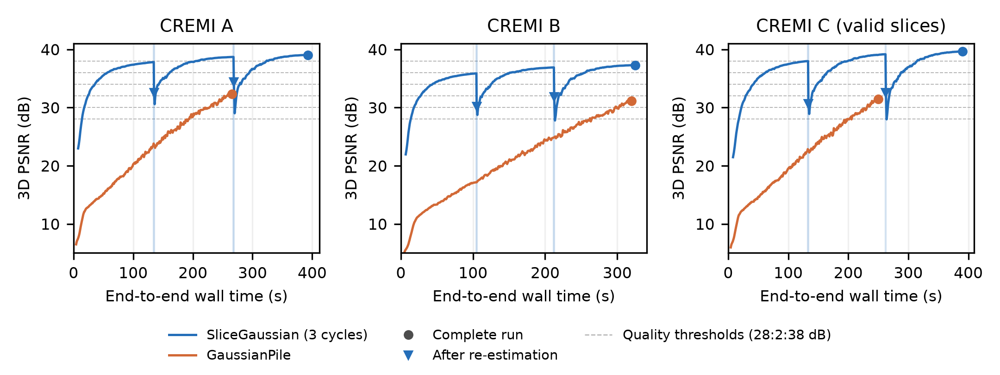

# End-to-end wall-clock study

The earlier efficiency claim mixed two questions: how soon a fit reaches a given
quality, and how long its complete optimisation schedule takes. The original
paper's 304–340 s for SliceGaussian and 207–211 s for GaussianPile are accounted
fitting times, including population analysis and re-estimation but excluding
metric evaluations and data loading. They are not complete process wall times.

The new comparison measures fresh-process time before package imports and volume
loading through the final synchronized evaluation and adequacy check. It includes
normalisation, CUDA context and runtime extension loading, Phase I, optimiser setup,
all optimisation CUDA operations, re-estimation and its checks, metric evaluations,
and progress logging. Model export and report generation happen after this clock.
CUDA synchronization brackets observations and population changes so asynchronous
work is not lost. `wall_seconds` is independent of the legacy `seconds` field.

Both methods use prebuilt extensions. The reproduction script loads/builds both
extensions in a separate preflight process before starting measured processes.
The first GaussianPile A attempt rebuilt its extension despite an existing cache;
that attempt is retained separately as a cold-cache diagnostic and A is repeated
with the rebuilt dependency. It is not mixed into the primary prebuilt-extension
comparison. Fresh CUDA context creation, module loading and all runtime device
operations remain inside the measured clocks.

There is one seed (0) per volume and method, 30,000 updates each. SliceGaussian
uses its full three-cycle protocol with re-estimation after updates 10,000 and
20,000, not the four-cycle allocation control from the previous study. GaussianPile
uses the original local paper baseline: one million random initial Gaussians,
zero slice thickness, paper normalisation, L1 + 0.2 D-SSIM, densification every
100 updates after 500 through 25,000, gradient threshold 5e-5, pruning threshold
0.02. Its original sampling of all planes, including blank C planes, is retained;
SliceGaussian samples its valid slices. Both are evaluated with the same clipped,
normalised whole-volume PSNR function on valid slices (123 on C).

Every 100 updates both methods render and evaluate the full volume. At zero,
every 5,000 updates, and the end, both also compute the same full metrics. This
measurement overhead is included in wall time. Re-estimation events receive
separate observations so that their time and fidelity changes remain visible.
No concurrent training jobs are run; the GPU also drives the desktop display.

The six fixed quality targets are **28, 30, 32, 34, 36 and 38 dB**, chosen before
these runs completed. Report the first *observed* crossing, without interpolation;
a later quality drop does not erase that crossing. An unreached target is marked
NR, never assigned an extrapolated or zero time. Curves show the actual PSNR,
not a monotone best-so-far envelope, and dots identify complete-run endpoints.
This makes earlier threshold attainment and a longer complete run visible together.

```bash
micromamba run -n gaussian-volume python scripts/reproduce_wallclock.py
MPLCONFIGDIR=/tmp/slicegaussian-mpl micromamba run -n gaussian-volume \
  python scripts/summarize_wallclock.py
```

Per-method folders in `runs/wallclock/cremi_{a,b,c}` contain `timeline.csv`,
`result.json`, progress logs and the exported final model. The root also contains
`manifest.json` (data/source hashes), `thresholds.csv`, `endpoints.csv` and the plot.
The new single-run measurements are reported separately from the historical
table (three seeds for SliceGaussian); differences in runtime are not attributed solely to evaluation
cost or inferred by subtracting old results from new ones.

## Measured results

Fresh, prebuilt-extension runs (seed 0; 30,000 updates each). These wall times include the common evaluation policy and are separate from the historical accounted-time table.

| Method | Final PSNR A / B / C (dB) | Complete wall time A / B / C (s) |
| --- | --- | --- |
| SliceGaussian, full three cycles | 39.05 / 37.29 / 39.65 | 392.9 / 325.0 / 390.5 |
| GaussianPile | 32.31 / 31.10 / 31.49 | 265.2 / 320.0 / 249.9 |

First observed time to quality (seconds), shown as **SliceGaussian / GaussianPile**:

| Target PSNR | CREMI A | CREMI B | CREMI C |
| --- | --- | --- | --- |
| 28 dB | 15.1 / 193.9 | 14.2 / 262.2 | 18.8 / 198.9 |
| 30 dB | 18.7 / 227.6 | 18.8 / 297.8 | 22.7 / 231.2 |
| 32 dB | 24.7 / 257.1 | 27.4 / NR | 29.3 / NR |
| 34 dB | 36.1 / NR | 44.3 / NR | 42.5 / NR |
| 36 dB | 56.8 / NR | 151.2 / NR | 62.6 / NR |
| 38 dB | 206.7 / NR | NR / NR | 200.1 / NR |

NR means not observed within the complete 30,000-update run, not impossible or infinitely slow. SliceGaussian reaches every shared, attained threshold earlier in these runs. Its full three-cycle fit ends at higher quality and takes longer than GaussianPile on each volume. These are separate outcomes; iteration-count comparisons do not establish shorter end-to-end runs.



[Threshold observations](wallclock_thresholds.csv) retain the preceding sample time and crossing iteration. [Complete-run endpoints and timing components](wallclock_endpoints.csv) retain full durations and final quality. Full traces, configurations, hashes and final models remain in `runs/wallclock`.
